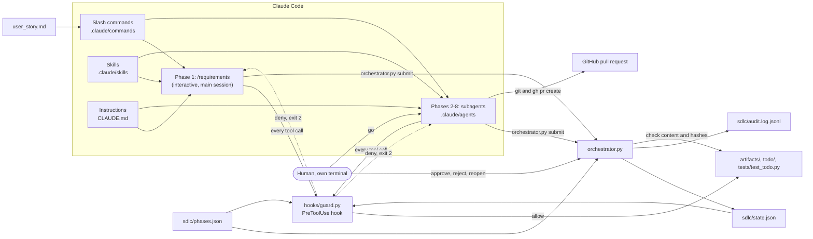

# Agentic SDLC with Claude Code

A demo repository in which one `user_story.md` is taken through eight SDLC
phases. Claude Code runs the work of each phase (requirements as an interactive
slash command, phases 2-8 as subagents), a human approves every phase before
the next one unlocks, and the last agent raises a pull request. Python 3.11+,
standard library only, `unittest` only.

The rules are in [docs/CONTRACT.md](docs/CONTRACT.md) (single source of
truth). A step-by-step reviewer demo is in [docs/RUNBOOK.md](docs/RUNBOOK.md).

## 1. What this project demonstrates

- AI agents doing real SDLC work (requirements, design, review, planning,
  coding, code review, verification, PR), one specialised agent per phase.
- Human in the loop: no agent can approve its own work or unlock the next
  phase. Approval is a deliberate human action in a separate terminal.
- Deterministic guard rails around non-deterministic models: a state
  machine, content checks at submit, hash-based tamper detection, an audit
  log and a pre-tool-use hook that blocks dangerous actions.
- An end-to-end result: the final agent branches, commits, pushes and opens a
  pull request, but only after the human has approved everything and said "go".

Nothing here is generated in advance. `artifacts/` is empty until a human
runs the pipeline live.

## 2. Why a Todo story

A command-line todo list is small enough to finish in one sitting, familiar to
every audience, and still has real requirements (ids, states, error cases).
It is only a vehicle: the phases, orchestrator and hook work for any story.
Replace `user_story.md` with any story and run the same phases (see "Using
your own story" in [docs/RUNBOOK.md](docs/RUNBOOK.md)). The one
example-specific part is the code file list under `todo/`, which appears in
`sdlc/phases.json` and in several agent and prompt files; a different story
that needs different code files means updating those by hand.

## 3. What "agentic SDLC" means here

A normal Copilot chat answers one request. Here a story passes through a
fixed assembly line. At each station one agent with a narrow job reads the
approved output of the previous station, writes exactly one document (or, for
implementation, the code), and stops. A script checks that document, and a
person decides whether the line moves on. The agents are free to be creative
inside their box; the script and the hook decide where the box is.

## 4. Who does what

| Piece | Role | Where |
|-------|------|-------|
| Instructions | Shared rules every agent follows | `CLAUDE.md` |
| Subagents | WHO does phases 2-8 (role, allowed files, procedure, self-check) | `.claude/agents/*.md` |
| Skills | HOW to do the work (reusable procedure and templates) | `.claude/skills/requirements/SKILL.md`, `.claude/skills/verify/SKILL.md`, `.claude/skills/pr/SKILL.md` |
| Slash commands | One-click kickoff a human runs, such as `/requirements` | `.claude/commands/*.md` |
| Orchestrator | State machine, submit checks, approval gate, audit log | `orchestrator.py`, `sdlc/phases.json` |
| Hook | Deterministic enforcement before every tool call | `hooks/guard.py`, `.claude/settings.json` |
| Human | The only approval authority | you, in your own terminal |

## 5. Lifecycle

```mermaid
flowchart TD
    U([user_story.md]) --> P1
    P1["1 requirements"] -->|submit| G1{"Human approves?"}
    G1 -->|approve| P2
    G1 -.->|reject| P1
    P2["2 architecture"] -->|submit| G2{"Human approves?"}
    G2 -->|approve| P3
    G2 -.->|reject| P2
    P3["3 design-review"] -->|submit| G3{"Human approves?"}
    G3 -->|approve| P4
    G3 -.->|reject| P3
    P4["4 planning"] -->|submit| G4{"Human approves?"}
    G4 -->|approve| P5
    G4 -.->|reject| P4
    P5["5 implementation"] -->|submit| G5{"Human approves?"}
    G5 -->|approve| P6
    G5 -.->|reject| P5
    P6["6 review"] -->|submit| G6{"Human approves?"}
    G6 -->|approve| P7
    G6 -.->|reject| P6
    P7["7 verify"] -->|submit| G7{"Human approves?"}
    G7 -->|approve| P8
    G7 -.->|reject| P7
    P8["8 pr (Stage A: pr.md and CHANGELOG.md)"] -->|submit| G8{"Human approves?"}
    G8 -.->|reject| P8
    G8 -->|approve| GO["Human says go"]
    GO --> PR(["Stage B: pull request raised by the pr agent"])
```



Dotted arrows are the reject loop: the same phase becomes ACTIVE again.
After a design-review verdict of REVISE the human can instead `reopen` the
architecture phase (see [docs/RUNBOOK.md](docs/RUNBOOK.md)).

## 6. Architecture



## 7. How the controls work

**Approval.** An agent finishes by running `python orchestrator.py submit <phase>`.
That moves the phase from ACTIVE to AWAITING_APPROVAL and records a SHA-256
hash of each owned file. The agent then stops and prints "Awaiting human
approval. Run: python orchestrator.py approve <phase> --by <your-name>". The
human runs `approve` (or `reject --reason ...`) in a separate terminal and
types the phase id to confirm. `approve`, `reject` and `reopen` refuse to run
without an interactive terminal, and the hook blocks agents from running them.

**Transitions.** The statuses are LOCKED, ACTIVE, AWAITING_APPROVAL and
APPROVED, in strict phase order. Only the ACTIVE phase can be submitted; only
an AWAITING_APPROVAL phase can be approved or rejected; only `approve` turns
the next phase from LOCKED to ACTIVE. `reject` returns the same phase to
ACTIVE, clears its hashes and logs the reason. `reopen` sends an APPROVED
phase back to ACTIVE and re-locks everything after it, but refuses while
later phases still have files on disk. Every submit, approve, reject, reopen
and check, including refusals, is written to `sdlc/audit.log.jsonl`. A state file that is corrupt or out of
order is rejected with a message telling the human how to restore it.

**Tamper detection.**
- `approve` recomputes the hashes and refuses if an owned file changed after
  submit.
- `python orchestrator.py check` re-verifies every APPROVED phase against its
  recorded hashes, reports files that exist for a still-LOCKED phase and
  reports missing protected paths.
- The hook (rules R07 and R08) blocks agent writes to protected files and to
  files owned by a phase that is not ACTIVE.

**Traceability.** Requirements define ids `FR-001`, `FR-002`, ... and
`NFR-001`, ... Submit refuses an artifact that fails its checks:

| Phase | Submit checks (besides owned files existing and being non-empty) |
|-------|-----------------------------------------------------------------|
| requirements | at least one FR id; an "## Open Questions" heading with no unchecked `- [ ]` items |
| architecture, planning | cites at least one defined id |
| design-review | cites at least one defined id; has a `Verdict: APPROVE` or `Verdict: REVISE` line |
| implementation | none beyond the owned files |
| review, pr | mentions every defined id |
| verify | mentions every defined id and contains a fenced code block |

Every phase after requirements also fails if it cites an id that the
requirements do not define.

## 8. Phases, agents, commands, skills and outputs

| # | Phase | Agent/Command | Skill | Output |
|---|-------|-------|-------|--------|
| 1 | `requirements` | `/requirements` (slash command) | `.claude/skills/requirements/SKILL.md` | `artifacts/requirements.md` |
| 2 | `architecture` | `.claude/agents/architecture.md` | none | `artifacts/architecture.md` |
| 3 | `design-review` | `.claude/agents/design-review.md` | none | `artifacts/design-review.md` |
| 4 | `planning` | `.claude/agents/planning.md` | none | `artifacts/implementation-plan.md` |
| 5 | `implementation` | `.claude/agents/implementation.md` | none | `todo/__init__.py`, `todo/app.py`, `todo/cli.py`, `tests/test_todo.py` |
| 6 | `review` | `.claude/agents/review.md` | none | `artifacts/review.md` |
| 7 | `verify` | `.claude/agents/verify.md` | `.claude/skills/verify/SKILL.md` | `artifacts/verify.md` |
| 8 | `pr` | `.claude/agents/pr.md` | `.claude/skills/pr/SKILL.md` | `artifacts/pr.md`, `CHANGELOG.md`, then the pull request |

The requirements phase (phase 1) is an interactive slash command that runs in
the main Claude Code conversation, allowing back-and-forth with the human.
Phases 2-8 are subagents that run autonomously and report results. All phases
use skills for reusable procedures and templates.

## 9. Repository structure

```
claude_code_capstone/
├── .claude/
│   ├── agents/
│   │   ├── architecture.md
│   │   ├── design-review.md
│   │   ├── implementation.md
│   │   ├── planning.md
│   │   ├── pr.md
│   │   ├── review.md
│   │   └── verify.md
│   ├── commands/
│   │   ├── architecture.md
│   │   ├── design-review.md
│   │   ├── implementation.md
│   │   ├── planning.md
│   │   ├── pr.md
│   │   ├── requirements.md
│   │   ├── review.md
│   │   └── verify.md
│   ├── skills/
│   │   ├── pr/
│   │   │   └── SKILL.md
│   │   ├── requirements/
│   │   │   └── SKILL.md
│   │   └── verify/
│   │       └── SKILL.md
│   └── settings.json
├── .editorconfig
├── .gitignore
├── .github/              (legacy, to be removed after tests pass)
├── artifacts/
│   └── .gitkeep
├── docs/
│   ├── CONTRACT.md
│   └── RUNBOOK.md
├── hooks/
│   ├── README.md
│   └── guard.py
├── sdlc/
│   ├── audit.log.jsonl
│   ├── phases.json
│   └── state.json
├── tests/
│   ├── __init__.py
│   ├── test_config.py
│   ├── test_docs.py
│   ├── test_e2e_pipeline.py
│   ├── test_guard.py
│   └── test_orchestrator.py
├── tools/
│   └── audit_repo.py
├── CLAUDE.md
├── orchestrator.py
├── README.md
└── user_story.md
```

`sdlc/state.json` and `sdlc/audit.log.jsonl` are created by the orchestrator.
The pipeline itself creates the other files later: the artifacts, the `todo/`
package, `tests/test_todo.py` and `CHANGELOG.md`. None of them exist before
the live run.

## 10. Quick start

Prerequisites:
- Python 3.11 or newer (`python --version`).
- Claude Code CLI (`claude --version`), or the Desktop app, or VS Code extension.
- Only for the final stage: the project folder is its own git repository with
  an `origin` remote, and the GitHub CLI (`gh`) is installed and signed in.

Check the starting state:

```
python orchestrator.py status
```

Expected: `requirements` is ACTIVE, the other seven phases are LOCKED, and
`approvalStatus: NOT_SUBMITTED`. Optionally run the tests:

```
python -m unittest discover -s tests -v
```

Run the first phase:
1. In your terminal, navigate to this folder.
2. Run `claude` to start Claude Code in this directory.
3. Type `/requirements`. This runs the interactive requirements phase.
4. Answer its clarifying questions in the chat.
5. When it prints the awaiting-approval line, open a second terminal and run
   `python orchestrator.py approve requirements --by <your-name>`, then type
   `requirements` to confirm.
6. Run `python orchestrator.py next`. It names the next subagent to run.

## 11. See the controls refuse

A blocked transition. While `requirements` is ACTIVE, try to skip ahead:

```
python orchestrator.py submit architecture
```

Expected, with exit code 1:

```
RULE VIOLATION: submit needs ACTIVE but 'architecture' is LOCKED. Run `python orchestrator.py next` to see what is allowed
```

A blocked command. Pipe a dangerous tool-call payload into the guard, in the
JSON format it reads (`tool_name` and `tool_input.command`). PowerShell:

```
'{"tool_name":"run_in_terminal","tool_input":{"command":"git reset --hard"}}' | python hooks/guard.py; $LASTEXITCODE
```

bash:

```
echo '{"tool_name":"run_in_terminal","tool_input":{"command":"git reset --hard"}}' | python3 hooks/guard.py; echo $?
```

Expected: a JSON deny decision on stdout, a readable "BLOCKED by SDLC guard
[R03]" message on stderr, and exit code 2. Replace the command with
`git status` to see it allowed (no output, exit code 0). More rules and
examples are in [hooks/README.md](hooks/README.md).

## 12. Known limitations

- **The guard is demo-grade.** It is regex-based, with no real shell parser,
  so a determined or creative command can slip past it. It is not complete
  shell-security coverage.
- **Human approval can be bypassed by a determined user.** The TTY check and
  typing the phase id stop accidents and agents, not someone who edits
  `sdlc/state.json` or calls the Python functions directly. Real protection
  is the hook plus pull-request review plus branch protection on the remote.
- **Hook support differs between Copilot surfaces.** This repo ships the VS Code
  (Local agent) hook format in `.github/hooks/hooks.json`. Copilot CLI and the
  cloud agent use a different file format, and on the CLI a hook that times out
  fails open. The tool names and `tool_input` field names that VS Code sends
  are not documented, so `hooks/guard.py` matches them heuristically; confirm
  them in your agent debug logs.
- **Agents cannot be technically prevented from writing outside their file
  with tools alone.** The agent files and prompts only instruct them. The hook
  narrows this by blocking writes to protected and not-ACTIVE files, but only
  for the paths it recognises.
- **Model output quality varies.** Submit checks verify structure and ids, not
  correctness. A human must read every artifact and the code before approving.
- **The audit log is append-only by convention.** It is not tamper-proof; keep
  or archive it and rely on git history for real evidence.
- **Hashes cover only the files a phase owns.** Other files are not hashed.
- **Stage B needs a proper git setup.** The `pr` agent refuses unless this
  folder is the git root and `origin` exists. It cannot succeed without both.
- **The pipeline run is manual.** Nothing here runs the agents for you.
- **The end-to-end test simulates the human.** `tests/test_e2e_pipeline.py`
  calls the orchestrator with `confirmed=True` in a temporary copy; it does not
  exercise the real TTY prompt or any Copilot behaviour, only the state
  machine, the hash checks and the guard.
- **Tests and tools are not hook-protected.** Only protected paths and
  phase-owned files are blocked. `tests/test_config.py`, `tools/audit_repo.py`
  and the other infrastructure tests are guarded by instructions and code
  review alone, so an agent could in principle edit them.

## Commands

| Command | Purpose |
|---------|---------|
| `python orchestrator.py status` | Show every phase and the current one (add `--json` for JSON) |
| `python orchestrator.py next` | Say which prompt to run, or what the human must approve |
| `python orchestrator.py submit <phase>` | Agent action: finish a phase |
| `python orchestrator.py approve <phase> --by <name>` | Human only: approve |
| `python orchestrator.py reject <phase> --reason <text>` | Human only: send back |
| `python orchestrator.py reopen <phase> --reason <text>` | Human only: rework an approved phase |
| `python orchestrator.py check` | Detect tampering and future-phase files |
| `python -m unittest discover -s tests -v` | Run all tests |
| `python -m compileall -q .` | Syntax check |
| `python tools/audit_repo.py` | PASS/FAIL audit of the real repo; valid only in the clean pre-demo state |
