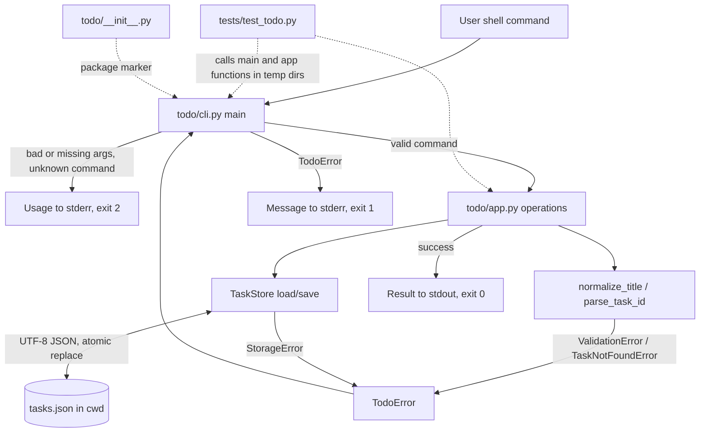

# Architecture

## Overview
A small Python 3.11+ command-line todo tool using only the standard library. Each invocation is a separate process: it parses argv, loads `tasks.json` from the current working directory, applies one command, saves if (and only if) the data changed, prints the result, and exits with a defined code. Logic is split into a pure-ish domain/storage layer (`todo/app.py`) and a thin argument/IO layer (`todo/cli.py`) so every FR can be tested with `unittest` without spawning processes (NFR-009). No network, no third-party packages (NFR-002, NFR-007).

Interpretations recorded (not new requirements):
- FR-011 says a "missing" id is a "not found" error (exit 1), while FR-014 says a command missing its required argument (for example `complete` with no id) is a usage error (exit 2). The design reads "missing" in FR-011 as "an id that does not exist in the list", and a completely absent id argument as a usage error per FR-014 (the more specific example). Raised to the human for confirmation.
- `add` takes exactly one title argument (the user quotes multi-word titles). Extra arguments are a usage error (FR-014).
- A `tasks.json` that is valid JSON but does not match the expected shape is treated as corrupt (FR-013).

## Components and responsibilities
| File path | Responsibility |
|-----------|----------------|
| `todo/__init__.py` | Package marker; may expose `__version__` only. No logic. |
| `todo/app.py` | Domain model, validation, storage and the command operations. Raises typed exceptions; never prints and never calls `sys.exit`. |
| `todo/cli.py` | Argument parsing, dispatch, output formatting, mapping exceptions to stderr messages and exit codes. Entry point `main`. |
| `tests/test_todo.py` | `unittest` tests covering every FR/NFR, using temporary directories. |

### Public interface of `todo/app.py`
| Name | Kind | Purpose |
|------|------|---------|
| `Task` | dataclass (`id: int`, `title: str`, `status: str`) | One task; status is `"open"` or `"done"`. |
| `TodoError` | exception base | Base for all expected, user-facing errors (carries a plain-language message). |
| `ValidationError(TodoError)` | exception | Empty or whitespace-only title. |
| `TaskNotFoundError(TodoError)` | exception | Id absent, non-numeric, zero or negative. |
| `StorageError(TodoError)` | exception | `tasks.json` unreadable, corrupt or wrong shape, or write failure. |
| `TaskStore` | class, constructed with a file `Path` (default `tasks.json` in the cwd) | Loads and saves the data file. |
| `TaskStore.load() -> tuple[list[Task], int]` | method | Returns tasks and next-id counter; missing or empty file gives `([], 1)`. |
| `TaskStore.save(tasks: list[Task], next_id: int) -> None` | method | Atomic UTF-8 write. |
| `parse_task_id(raw: str) -> int` | function | Converts text to a positive int or raises `TaskNotFoundError`. |
| `normalize_title(raw: str) -> str` | function | Strips whitespace; raises `ValidationError` if empty. |
| `add_task(store, title: str) -> Task` | function | Creates and persists a task. |
| `list_tasks(store) -> list[Task]` | function | Tasks in creation order. |
| `complete_task(store, raw_id: str) -> bool` | function | True if changed, False if already done. |
| `reopen_task(store, raw_id: str) -> bool` | function | True if changed, False if already open. |
| `delete_task(store, raw_id: str) -> None` | function | Removes a task. |

### Public interface of `todo/cli.py`
| Name | Purpose |
|------|---------|
| `main(argv: list[str] \| None = None) -> int` | Runs one command and returns the exit code (0, 1 or 2); output goes to `sys.stdout` / `sys.stderr`. |
| `build_usage() -> str` | Returns the usage text. |
| `if __name__ == "__main__"` guard | Calls `sys.exit(main())`. Runnable via `python -m todo.cli`. |

Argument parsing is hand-written (not `argparse`) so that ids such as `-1` are read as ids and not options, and so that the usage exit code is exactly 2 under our control.

## Data model and persistence
- State lives only in `tasks.json` in the current working directory, UTF-8 JSON, written with `ensure_ascii=False` so Unicode titles are stored unchanged (FR-012, NFR-006).
- Schema: an object with `"next_id"` (integer >= 1) and `"tasks"` (array in creation order) whose items are objects with `"id"` (integer >= 1), `"title"` (string) and `"status"` (`"open"` or `"done"`).
- Example shape (prose): `{"next_id": 4, "tasks": [{"id": 1, "title": "buy milk", "status": "open"}]}`.
- Id rule: a new task gets `next_id`, then `next_id` is incremented and stored in the same save. Deleting never decrements the counter, so ids are never reused, including across restarts (FR-003).
- Validation on load: invalid JSON, wrong types, duplicate ids, unknown status, or `next_id` not greater than every existing id means the file is corrupt (`StorageError`).
- Missing file, or a file that is empty or whitespace-only, means no tasks and `next_id` 1 (FR-012). Nothing is written for read-only commands (list) or no-op commands.
- Write strategy: write the full new content to a temporary file in the same directory, then `os.replace` onto `tasks.json`, so a failed write cannot leave a half-written file (NFR-005). Save is called only after the operation has fully succeeded in memory.
- Concurrent runs are out of scope (human).

## Control/data flow
Common flow: `main(argv)` -> parse command and arguments -> (usage error: print usage to stderr, return 2) -> create `TaskStore` -> call the app function -> format output -> return 0. Any `TodoError` is caught in `main`, its message is written to stderr as `Error: <message>`, and 1 is returned.

1. `add <title>` (FR-001, FR-002, FR-003): `normalize_title` -> `load` -> build `Task(next_id, title, "open")` -> `save` with `next_id + 1` -> print `Added: <id> [open] <title>` -> 0. Empty title: `ValidationError` before any load or save -> stderr, 1.
2. `list` (FR-004, FR-005): `load` -> print `<id> [open|done] <title>` per task in stored order, or `No tasks.` if empty -> 0. Never saves.
3. `complete <id>` (FR-006, FR-007, FR-011): `parse_task_id` -> `load` -> find task. Not found: `TaskNotFoundError` -> 1. Open: set done, `save`, print nothing, 0. Already done: no save, print `Task <id> is already done.` to stdout, 0.
4. `reopen <id>` (FR-008, FR-009, FR-011): mirror of complete; already open prints `Task <id> is already open.`, 0.
5. `delete <id>` (FR-010, FR-011): `parse_task_id` -> `load` -> remove task -> `save` (counter unchanged) -> print nothing -> 0.
6. Failure paths: corrupt or unreadable file (FR-013) makes `load` raise `StorageError` before any write, so the file is untouched; exit 1. Usage errors (FR-014) never reach the store, so no data changes; exit 2.

## Mermaid diagram

## Decisions
| # | Decision | Ids | Rationale |
|---|----------|-----|-----------|
| D1 | Split into `app.py` (logic, no printing or exiting) and `cli.py` (IO and exit codes). | NFR-009, NFR-003, NFR-004 | Domain code can be unit tested directly; exit codes and streams are controlled in one place. |
| D2 | Store `next_id` alongside tasks in `tasks.json`. | FR-003, FR-012 | Required by the human answer; only a persistent counter prevents reuse after deleting the highest id and restarting. |
| D3 | Typed exceptions (`ValidationError`, `TaskNotFoundError`, `StorageError`) all deriving from `TodoError`; `main` catches only `TodoError` plus specific `OSError` / `json.JSONDecodeError` / `UnicodeDecodeError` inside the store. | NFR-004, NFR-008, FR-011, FR-013 | Plain-language messages with no stack trace; no bare `except:`. |
| D4 | Hand-written argv parsing instead of `argparse`. | FR-011, FR-014, NFR-003 | `-1` must parse as an id (giving exit 1 "not found"), and usage errors must be exactly exit 2. |
| D5 | `parse_task_id` accepts only a string of ASCII digits representing an integer >= 1; anything else raises the same "not found" error as an absent id. | FR-011 | One uniform error for `abc`, `0`, `-1` and `99`. |
| D6 | Atomic save through temp file plus `os.replace`; save only after the operation succeeds; never save on no-ops or reads. | NFR-005, FR-007, FR-009, FR-013 | A failed command leaves the file unchanged; corrupt data is never overwritten. |
| D7 | Load validates the schema strictly and treats mismatches as corrupt. | FR-013, NFR-005 | Prevents silently rewriting data the tool does not understand. |
| D8 | Open the file with `encoding="utf-8"` and write JSON with `ensure_ascii=False`; configure stdout/stderr text with UTF-8 where reconfigurable. | NFR-006, FR-002, FR-012 | Unicode titles are preserved unchanged in storage and display. |
| D9 | Title is trimmed with `str.strip()` and validated before the file is read. | FR-002 | Rejected input cannot touch storage; no maximum length is enforced. |
| D10 | Already-done/already-open messages go to stdout with exit 0; success of complete/reopen/delete prints nothing. | FR-006, FR-007, FR-008, FR-009, FR-010, NFR-003 | Matches the human's answers on confirmations and exit codes. |
| D11 | Only `os`, `sys`, `json`, `pathlib`, `tempfile`, `dataclasses` and `unittest` are used; no sockets or URL modules. | NFR-001, NFR-002, NFR-007 | Stays inside the contract. |
| D12 | PEP 8 and full type hints; code must pass `python -m compileall -q .`; tests run with `python -m unittest discover -s tests -v`. | NFR-001, NFR-008, NFR-009 | Quality and testability gates. |

## Error handling
| Situation | Raised as | stderr message (plain language) | Exit | File effect |
|-----------|-----------|----------------------------------|------|-------------|
| Empty or whitespace-only title | `ValidationError` | `Error: title must not be empty.` | 1 | none |
| Id absent, `abc`, `0`, `-1` | `TaskNotFoundError` | `Error: task not found: <id>.` | 1 | none |
| `tasks.json` invalid JSON, wrong shape, or unreadable (permission, decode error) | `StorageError` | `Error: cannot read tasks.json: <reason>. The file was not changed.` | 1 | untouched |
| Write failure on save | `StorageError` | `Error: cannot write tasks.json: <reason>.` | 1 | original kept (atomic replace); temp file removed |
| No command, unknown command, missing or extra arguments | usage handling in `cli.py` | usage text | 2 | none |
| Already done / already open | not an error | message on stdout | 0 | none |

No stack trace is ever shown; unexpected exceptions are not swallowed by a bare `except:`. Streams: all errors and usage go to stderr; normal output goes to stdout.

## Requirement coverage table
| Id | Component(s) | How |
|----|--------------|-----|
| FR-001 | `todo/app.py` (`add_task`), `todo/cli.py` (output) | Create open task with new id; print `Added: ...`. |
| FR-002 | `todo/app.py` (`normalize_title`, `ValidationError`), `todo/cli.py` | Trim, reject empty, exit 1, Unicode unchanged. |
| FR-003 | `todo/app.py` (`TaskStore`, `next_id`) | Sequential ids from persistent counter, never reused. |
| FR-004 | `todo/app.py` (`list_tasks`), `todo/cli.py` | Creation-order lines `<id> [status] <title>`. |
| FR-005 | `todo/cli.py` | Print `No tasks.` when list empty. |
| FR-006 | `todo/app.py` (`complete_task`), `todo/cli.py` | Open -> done, silent, exit 0. |
| FR-007 | `todo/app.py` (`complete_task` returns False), `todo/cli.py` | Message, no save, exit 0. |
| FR-008 | `todo/app.py` (`reopen_task`), `todo/cli.py` | Done -> open, silent, exit 0. |
| FR-009 | `todo/app.py` (`reopen_task` returns False), `todo/cli.py` | Message, no save, exit 0. |
| FR-010 | `todo/app.py` (`delete_task`), `todo/cli.py` | Remove task, silent, counter kept. |
| FR-011 | `todo/app.py` (`parse_task_id`, `TaskNotFoundError`), `todo/cli.py` | Uniform not-found error, exit 1. |
| FR-012 | `todo/app.py` (`TaskStore`) | `tasks.json` in cwd, UTF-8 JSON with next-id; missing/empty means empty list. |
| FR-013 | `todo/app.py` (`TaskStore.load`, `StorageError`), `todo/cli.py` | Strict load, error exit 1, no write. |
| FR-014 | `todo/cli.py` (`main`, `build_usage`) | Usage on stderr, exit 2, store never touched. |
| NFR-001 | all of `todo/*` | Python 3.11+ features only; no older-version shims. |
| NFR-002 | `todo/app.py`, `todo/cli.py`, `tests/test_todo.py` | Standard library and `unittest` only. |
| NFR-003 | `todo/cli.py` (`main`) | Exit 0/1/2 mapping; errors to stderr. |
| NFR-004 | `todo/app.py` (exceptions), `todo/cli.py` | Plain messages, no traceback, stderr. |
| NFR-005 | `todo/app.py` (`TaskStore.save`, `load`) | Atomic write; no save on failure/no-op; corrupt file never overwritten. |
| NFR-006 | `todo/app.py` (`TaskStore`), `todo/cli.py` | UTF-8 read/write, `ensure_ascii=False`. |
| NFR-007 | `todo/app.py`, `todo/cli.py` | No network modules used. |
| NFR-008 | `todo/app.py`, `todo/cli.py`, `tests/test_todo.py` | PEP 8, type hints, specific exceptions only. |
| NFR-009 | `tests/test_todo.py`, `todo/__init__.py` | Tests for every FR via `unittest discover`; package compiles cleanly. |
